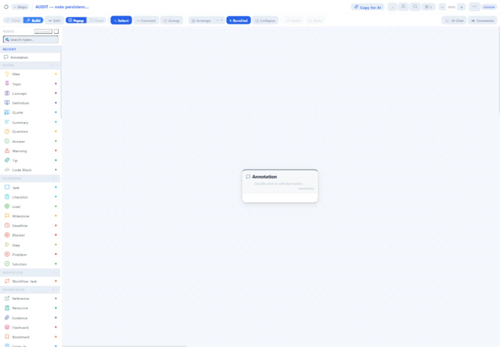
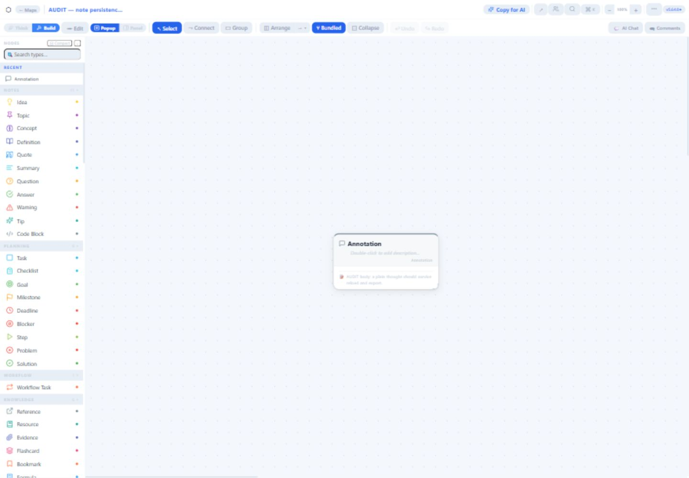
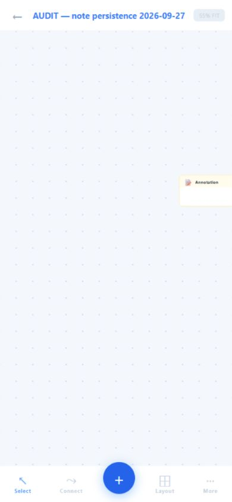

# NoNote audit and note-first roadmap

Reviewed 27 September 2026. Source baseline: main `97028e87d5a92a775048e103783136d578aa6aa6`; backend and test instance version 5.64.0. This is an audit and proposal, not an implementation release.

## Recommendation

Keep NoNote a visual notebook: capture a thought, connect it to another, develop it into a useful note, and reliably retrieve/export it. Keep homelab diagramming as an optional type pack and live integrations as optional modules. Management actions can be added later behind separate permissions. Start with a modular monolith and trusted bundled modules; a third-party plugin marketplace is premature.

| Requested question | Answer |
| --- | --- |
| Can reliability be assessed? | Yes. Significant defects remain despite passing tests; it is not yet dependable enough for notes without additional safeguards. |
| Is there dead code? | Yes. One production-unreachable component plus several obsolete branches; legacy note code needs migration before removal. |
| Are there mistakes? | Yes. Saving, authorization, refresh tokens, exports, mobile contracts and operational tooling have actionable issues. |
| Can it become plugin-style? | Yes. Extract shared document and authorization contracts before extracting integrations. |
| Can the UI become more human and note-focused? | Yes. Prioritize writing, readable content and predictable interactions over options and dashboard controls. |
| Are there additional concerns? | Yes. Backup restore, migration readiness, credential handling, accessibility, dependency maintenance, and coverage of actual user journeys. |

## Evidence and limits

Inventory: 65 production source files, 21,402 lines including changelog, with a static import graph. This was a whole-repository inventory and risk-focused deep review, not a proof that every line and every deployment path is correct. See [inventory](inventory.json).

Checks already completed against the baseline:

- Frontend: 197 tests in 23 files passed; lint had zero errors and 27 warnings; production build succeeded.
- Backend: 134 tests in nine files passed; lint clean.
- Nine additional audit assertions reproduced defects: six backend and three frontend. These deliberately assert current bad behavior and are isolated from normal tests in `audit/*.repro.js`. Passing them means the defect exists, not that the product is correct.
- npm advisory checks reported seven affected frontend package entries (four high, three moderate), and ten backend entries (three high, seven moderate). These include development dependencies and transitive packages; they are not counts of demonstrated runtime exploits. No upgrades or lockfile changes were made. Backend metadata submission was explicitly authorized.
- Built frontend inspected using a synthetic local API in light/dark and desktop/mobile views. This validates presentation, not production persistence.
- Authenticated real test instance inspected as owner. Created only `AUDIT — note persistence 2026-09-27` for mutation tests. The test map is retained as evidence.

Real-instance observations:

1. Created a map and a single node; waited for its save. Deleted its sole node, observed an empty canvas, then reloaded. The node returned. **Last-node deletion failure confirmed end to end.**
2. Edited the node's short description and note body, allowed autosave, then reloaded. The note body survived; the description reverted to the empty placeholder. **Description loss confirmed end to end; ordinary node-body persistence passed this scenario.**
3. At 390×844, the same node appeared by title but its saved note body was absent from the canvas. This establishes a presentation difference, not a live proof of every mobile save failure described below.
4. Desktop canvas presents the large type palette and diagram controls. Plain Note is under General, while Notes lists eleven specialized types. Home foregrounds map/node counts, Live Dashboard, Activity, Groups and administration.

Limits: no two-account live collaboration test, cross-map exploit, live role escalation, restore drill, real appliance test, load test, exhaustive accessibility audit or complete real-instance export/import round trip was performed. Those findings are labeled source/reproduction evidence below. No real integrations or AI providers were invoked. Browser coordinate targeting at an overridden viewport was inconsistent; keyboard submission was used where supported. Do not attribute mis-targeted type selection to the application without a separate manual reproduction.

## Prioritized findings

P0 means address before expanding sharing or trusting sensitive credentials. P1 means address before substantial note-first feature work. P2 is important follow-up. “Reproduced” refers to isolated real code with mocked external services unless explicitly marked live.

| ID / priority | Finding and evidence | Required outcome |
| --- | --- | --- |
| A01 / P0 | Map GET returns private note fields and integration properties to viewers. `backend/src/routes/maps.js:143` selects full rows; response includes `node_notes`, `notes_private`, and properties. Reproduced a viewer receiving a private body and `_integration.token`. `IntegrationPanel.jsx` stores credentials in node properties; version/export/WS paths also need the same policy. | Server-side field filtering for every read channel; secret references instead of credential values in document JSON. Define exactly who may read private notes. |
| A02 / P0 | Save upserts conflict on globally unique node ID without asserting the existing node belongs to the target map (`maps.js:366–370`). Source permits a known node UUID from another map to be updated through a writable map. Endpoint FK checks do not enforce same-map edges. Not exploited on the test server. | Validate ownership of all submitted IDs and endpoints inside the transaction; add two-map negative tests. |
| A03 / P0 | WS join authorizes read access, but subsequent mutation payloads are broadcast without editor authorization or a message allowlist (`backend/src/index.js:181,221,259`). Actual handler reproduction confirms viewer `nodes_update` reaches another socket. Receiving editors may later persist that state. | Shared REST/WS capability checks, schema validation, read-only viewer enforcement, token expiry/revocation handling, safe join lifecycle. |
| A04 / P0 | Admin user PATCH accepts password updates for an owner target; the target's role is not protected as the new-role assignment is. Reproduced route accepting an owner password reset (`backend/src/routes/users.js`). | Explicit actor/target policy for every password, role and active-status change; admins cannot take over owners. |
| A05 / P1 | Refresh JWTs are hashed directly with bcrypt (`auth.js:61,128,168`). Distinct signed same-user tokens share the first 72 bytes and compare equal in the reproduction. A valid old token can match another active same-user token record, undermining rotation. This does not allow arbitrary JWT forgery. | Hash the complete token with SHA-256/HMAC or index a verified jti; atomic rotation and replay handling; revoke sessions consistently. |
| A06 / P1 | Last-node deletion fails in both layers. `NodeCanvas.jsx:244` skips empty snapshots; `maps.js:413` skips node deletion when incoming nodes is empty. Reproduced route behavior and confirmed live node resurrection after reload. | Saving an empty document must clear it and remain empty after reload, reconnect and export. |
| A07 / P1 | `scheduleSave` captures stale groupBoxes with incomplete callback dependencies. Retry closures retain old snapshots and overlapping saves have no document revision check. Source inspection; no live group/concurrent-save test. | Current complete document snapshots, ordered/coalesced writes, optimistic revision checks and recoverable local drafts. |
| A08 / P1 | Every edge ID is regenerated (`maps.js:358`) despite valid UUIDs; subsequent deletion/upsert behaves as replacement. Reproduced fresh edge IDs. Contradicts the documentation's concurrency-safe upsert claim. | Preserve valid IDs, return canonical mappings for temporary IDs, reject stale revisions and test simultaneous edits. |
| A09 / P1 | Node description is editable but absent from saved map-node contract. Live body persisted while description disappeared. Other transient fields also need an explicit persistence inventory. | Every editable field is either persisted, explicitly transient, or removed from the editing UI; round-trip fixtures cover each. |
| A10 / P1 | Desktop popup edits `node_notes`, while side-panel rich notes use legacy `notes[]`. Client-side load migration strips/reshapes legacy content and can generate extra nodes. Multiple editors/exporters do not share a canonical model (`NodeCanvas.jsx:402–473`, `PropsPanel.jsx`, `NodeNotesTab`). | Versioned, idempotent migration with backups and fixtures; one editor and serialization contract across desktop/mobile/AI/export. |
| A11 / P1 | Exports/imports are not reliable note backups. Dashboard `.nonote` mapping drops new note/privacy fields and groups; several document exporters use only `notes[]`. Reproduced Markdown omission of `node_notes`; HTML inserts title markup unescaped; native export retains secrets in `customProps`. | Lossless versioned native round trip, escaped/sanitized publication output, explicit private-note export policy, recursive secret exclusion. |
| A12 / P1 | Mobile loads raw DB-shaped nodes/edges but works with frontend `type/from/to` fields. Save sends empty groups and errors are swallowed (`MobileCanvas.jsx`). Source predicts save failures or discarded groups. Live mobile view showed title without the desktop note body. | Shared adapters/editor/save service; test mobile edit→desktop reload and back, preserving edges/groups/privacy. |
| A13 / P1 | Effective permission/settings calculations are largely display metadata; registration uses an env gate, while viewer AI/export and other settings lack corresponding enforcement. UI canEdit uses global role rather than actual map grant. | One server capability model, enforced settings and per-map capability response used by both clients. |
| A14 / P1 | Operational safety gaps: migrations suppress errors and server readiness is not tied to completion; health is insufficient to prove DB readiness. Backup pipeline can mask pg_dump failure before retention. Rotating JWT access secret also changes the derived LLM encryption key (`utils/crypto.js`, `rotate-secrets.sh`). Source evidence only. | Fail visibly on migration errors; readiness checks; atomic verified backups plus restore drill; separate versioned encryption key and migration procedure. |
| A15 / P1 | Integration URL checks are lexical and do not resolve/check destination IPs through DNS; request body accumulation is unbounded and header-time timeout handling is insufficient. Generic probe accepts caller-controlled methods. RFC1918 access itself is intentional. | Explicit allowed destinations and methods, read/write capabilities, bounded responses, abortable total deadlines, credential broker. |
| A16 / P2 | Comments live only in component state and are not persisted; dashboard sharing sends user_id while backend expects email and reads inconsistent collaborator IDs. Source evidence. | Persisted comments or honest temporary annotation UI; shared request/response schema and error display for sharing. |
| A17 / P2 | LLM history selects earliest 60 messages (`llm.js:329`) before trimming, so recent turns eventually fall out. Some AI contexts still depend on legacy notes. | Select newest bounded history then restore chronological order; current note model and explicit privacy-aware context selection. |
| A18 / P2 | 146 static matches of CSS variable values followed by hex alpha, e.g. `var(--accent)22`, produce invalid color values after substitution. Tiny labels and low-contrast muted text also occur in interactive controls. | `color-mix` or proper alpha tokens; readable typography, contrast and focus checks across light/dark skins. |
| A19 / P2 | Development Vite proxy covers /api but not /ws; single backend memory rooms cannot scale horizontally. Large main/ELK chunks and pervasive broad canvas state increase maintenance/performance costs. | Working development collaboration, documented single-instance limit, lazy optional modules and measured canvas performance budgets. |

Other concerns to include during remediation: standalone integration secrets persisted in browser localStorage; raw rich HTML handling requires a single sanitization policy; map versions omit parts of document state; pending saves/unmount and room-join-before-load races need tests; no durable offline draft; avoid treating a retry as permission to overwrite newer content.

## Dead code and documentation

- `frontend/src/components/canvas/SearchPanel.jsx` is unreachable from the production import graph; active search lives in NodeCanvas. Its unit tests do not prove production use. Candidate for removal after confirming no planned reuse.
- `App.jsx` alternate navigation layout branches are unreachable with all shipped skins using top navigation. Remove only after deciding whether the option is a supported extension contract.
- Unused theme event listener (`nn-skin-force-theme`), write-only firstMount bookkeeping, unused backend pool/Redis exports and constant/unused canvas state are cleanup candidates, not the first priority.
- RichTextEditor, NoteCard and legacy note structures are **not safely removable dead code**: live panel paths still use them. Migrate before deleting.
- Layout fallback/radial code is still reachable. Do not remove based on an unused-looking import or isolated UI path.
- Documentation drifts: test/file-size claims, concurrency guarantees and migration descriptions disagree with source. `postgres/migrate.sql` exists; establish its operational ownership before removing it. Keep one version source and document actual supported behavior.

## Why the interface feels mechanical

This is a design assessment, not a claim that visual taste has an objectively correct answer. The app asks users to classify and configure information before expressing it. Numerous similarly weighted toolbar actions, specialized node types, diagram routing controls, map statistics and management navigation compete with writing. Small uppercase labels, glyph-heavy controls and muted text create a control-panel feel. Popup and panel editing expose different content structures, making behavior harder to learn. Adding more skins will not resolve those workflow problems.

Proposed experience:

1. Home opens with recent notes/maps, search and a clear “New note” action. Show a short content preview and useful recency, not infrastructure metrics by default.
2. A new canvas focuses a plain note editor immediately. A thought does not require choosing from 118 types. Type specialization is optional and reversible.
3. Keep a small primary toolbar: add note, connect, search, undo. Put layout, export and advanced controls in contextual menus. Offer discoverable Enter-for-sibling / Tab-for-child commands with mouse equivalents.
4. Use one body editor and predictable selection behavior on desktop and mobile. Show readable note content on the canvas; open details for longer writing. Explain saved, saving, offline and failed states in plain language.
5. Keep comfortable spacing and readable sentence-case labels, use icons with text for unfamiliar actions, and make focus/hover/selection states clear. Preserve the existing theme/color, spacing/design and skin/personality separation.
6. Homelab-enabled users can add a type palette, inspector and live dashboard; these do not occupy the default notebook navigation. A connected note is not automatically an annotation merely because of its graph degree: model that relationship explicitly.

Validate with five real tasks: capture a thought; connect two ideas; find yesterday's note; correct a mistake; export and reimport without loss. Target first capture within ten seconds as a design goal, then measure with users. Include keyboard-only operation, 200% zoom, reduced motion, screen-reader labels, and a light/dark theme pair. This audit did not certify WCAG conformance.

## Plugin architecture proposal

### Core owns durable documents and trust

Keep authentication, authorization, document revisions, stable IDs, nodes/edges/groups, note content, search, undo/redo, serialization, export policy, draft recovery and accessibility in core. Prefer a versioned Markdown note body with safe rendering as the initial direction, subject to preserving existing rich-text content during migration. If structured rich text is required, choose it deliberately before migrating; do not keep two active authoritative body formats.

Define a canonical Document schema and adapters at API/storage boundaries. Share those adapters across mobile and desktop. Changes go through documented commands such as createNote, updateBody and connectNodes, with validation and revision checks. Plugins do not receive raw setNodes, unrestricted SQL, or auth tokens.

### Extract in increasing order of risk

| Layer | Examples | Contract |
| --- | --- | --- |
| Declarative type packs | Homelab nodes, templates, optional planning types | Namespaced type ID, labels/icons, validated fields and defaults; no network credentials |
| Trusted bundled modules | Read-only Proxmox/TrueNAS dashboard; optional AI | Manifest, minimum core API version, module data schema version, commands and UI slots; lazy loading and error boundaries |
| Server adapters | Appliance polling and AI calls | Core-enforced capabilities, destination policy, secret references, bounded requests and audit records |
| Optional management module | Explicit appliance write actions | Separate write permission, action review and auditability; never implied by diagram access |

Use namespaced types such as `homelab.proxmox` with legacy aliases/migrations. Offer slots for inspector sections, commands, settings and optional pages. Store extension data in namespaces and retain it when a module is disabled. Unknown types render a generic fallback preserving their contents. Disabling a module cancels polling/listeners and removes its UI without deleting user data.

Installation enablement and a user's workspace preference are different from authorization; hiding a module never grants or revokes backend access by itself. Shared read/private/export rules apply to all contributions.

Bundled JavaScript modules are a code organization boundary, not a security sandbox. Do not load arbitrary third-party scripts into the authenticated app. A future untrusted plugin system needs a separately designed isolation/RPC and capability model, potentially sandboxed iframes and isolated server processes. A worker alone is not a complete trust boundary.

## Implementation sequence for approval

| Phase | Work | Exit checks |
| --- | --- | --- |
| 1 — Protect notes and accounts | A01–A09 authorization/save/token fixes, immediate export safeguards, verified backup before migrations | Viewer cannot read secrets/private bodies or mutate via WS; foreign-map UUID rejected; admin cannot reset owner; token replay rejected; last-node deletion, descriptions, groups and stable edges survive reload |
| 2 — Unify the note core | Canonical document schema, one note editor, shared desktop/mobile adapters, revision-aware persistence, versioned native import/export and migration | Representative legacy documents migrate once without loss; import/export round trip preserves every supported field; offline/retry/concurrent-edit scenarios do not silently overwrite content |
| 3 — Make writing the default | Note-first home/canvas, smaller toolbar, progressive disclosure, usable text/focus/contrast; fix CSS colors | Core note tasks work without homelab concepts; keyboard/mobile/light/dark checks pass; usability feedback collected |
| 4 — Pilot optional homelab | Declarative type registry, namespaced data, one read-only integration module with server credential broker | Core runs with module disabled; existing homelab content remains readable; enable/disable and failed polling preserve notes and cancel resources |
| 5 — Extend only after the pilot | Optional AI/workflow/management modules; remaining dead-code cleanup, operations and performance follow-up | Explicit capability tests, migration/rollback docs, update/backup restore drill and measured performance; decide separately whether third-party loading is needed |

Do not start with a rewrite, microservices or marketplace. Extract small interfaces while preserving working canvas behavior, including DOM-measured node heights and edge layer ordering. Refactor NodeCanvas by responsibility only after the document/save contracts have protective tests.

## Reproduction and artifact notes

Run from each project directory:

```text
npm exec -- vitest run --config audit/vitest.config.js
```

Backend suite mocks PostgreSQL/Redis; frontend suite captures export output without downloading files. These audit assertions must be inverted/replaced with desired-behavior regression tests during fixes. They intentionally do not join default `npm test` discovery.

`backend/audit/inventory.mjs` regenerates the inventory. `backend/audit/preview.mjs` is a synthetic preview helper, not the deployed backend. Screenshots labeled canvas/dashboard/think came from that preview; `test-login-dashboard.png`, `last-node-returned.png`, `description-lost.png` and `mobile-note.png` came from the authenticated test instance. No credentials belong in these artifacts or a commit. The local `.nonote-test-credentials.txt` remains a private untracked file and must not be staged.







Application source, dependencies and deployment were not changed. No commit, push or production action was performed. The next approval should cover Phase 1 implementation; this report does not claim the listed limitations were tested.
